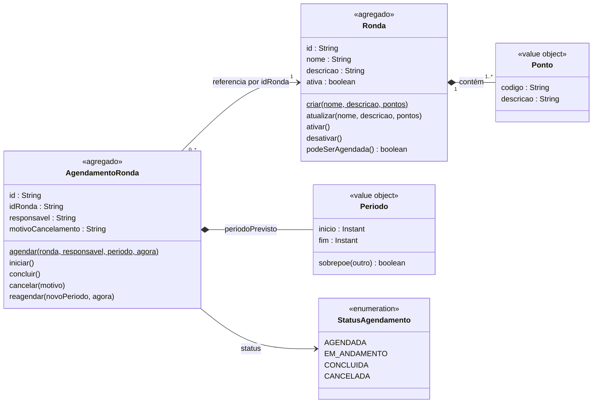
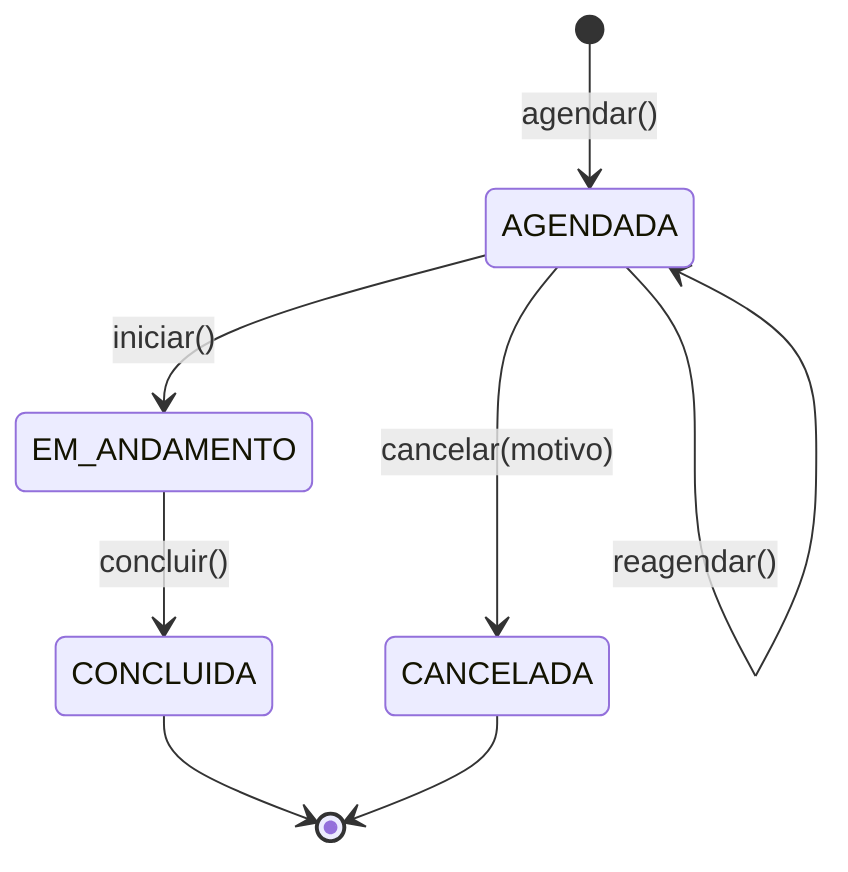

# schedule-patrol-api

API REST de agendamento de rondas de inspeção em gasodutos, desenvolvida como Prova de Conceito (POC). O sistema utiliza exclusivamente dados fictícios e anonimizados, respeitando as leis de sigilo asseguradas pela LGPD.

**Stack:** Java 21 · Spring Boot 4.1 · Maven · MongoDB 8 · Docker Compose · springdoc-openapi (Swagger)

---

## Sumário

1. [O que a API faz](#1-o-que-a-api-faz)
2. [O domínio](#2-o-domínio)
3. [Arquitetura](#3-arquitetura)
4. [Pré-requisitos](#4-pré-requisitos)
5. [Configurando o `.env`](#5-configurando-o-env)
6. [Rodando a API](#6-rodando-a-api)
7. [Horários para teste (local e UTC)](#7-horários-para-teste-local-e-utc)
8. [Endpoints](#8-endpoints)
9. [Testes](#9-testes)
10. [Problemas comuns](#10-problemas-comuns)
11. [Limites conhecidos e próximos passos](#11-limites-conhecidos-e-próximos-passos)

---

## 1. O que a API faz

Uma malha de gasodutos precisa ser inspecionada periodicamente em campo. Esta API organiza esse trabalho:

- **cadastra rondas**, que são roteiros de inspeção com uma sequência de pontos a visitar;
- **agenda a execução** dessas rondas para um responsável, num período previsto;
- **acompanha o ciclo de vida** de cada agendamento: agendado, em andamento, concluído ou cancelado.

O projeto é a primeira de três camadas de evolução:

| Camada | Entrega | Status |
| --- | --- | --- |
| 1 | API em camadas + domínio rico + MongoDB | ✅ esta versão |
| 2 | Eventos no Kafka a cada mudança de estado (ex.: e-mail ao agendar ou cancelar) | planejada |
| 3 | Consumidor extraído para um microserviço de notificação | planejada |

---

## 2. O domínio

### Domínio rico (DDD tático)

O projeto segue a filosofia de **domínio forte**: as regras de negócio vivem **dentro** das entidades, não espalhadas em services.

- Entidades **não têm setters**. O estado só muda por métodos com nome do negócio: `agendamento.iniciar()`, `agendamento.cancelar(motivo)`, `ronda.desativar()`.
- Objetos **nascem válidos**. As invariantes são checadas na criação, e um objeto inválido nunca existe.
- Violação de regra lança uma **exceção de domínio específica** (todas herdam de `DomainException`).
- A camada de domínio é **Java puro**: não conhece Spring, MongoDB nem HTTP. Um teste de arquitetura (ArchUnit) quebra o build se isso for violado.

### Conceitos

**Ronda:** um roteiro de inspeção. Tem nome, descrição, uma lista ordenada de **pontos** e pode estar ativa ou inativa.

**Ponto:** um local a ser inspecionado dentro de uma ronda (código + descrição). É um *value object*: não tem identidade própria e só existe dentro da Ronda.

**Agendamento de ronda:** a execução planejada de uma ronda por um responsável, num **período previsto** (início e fim).

**Período:** *value object* com início e fim. Garante que o início vem antes do fim e sabe responder se se sobrepõe a outro período.

### Modelagem



Ronda e AgendamentoRonda são **agregados separados**: um referencia o outro apenas pelo id e nunca contém o outro.

### Ciclo de vida do agendamento



Qualquer transição fora desse diagrama lança `TransicaoDeStatusInvalidaException` (HTTP 409).

### Regras de negócio

**Ronda**
- Nome obrigatório e ao menos 1 ponto.
- Não pode haver dois pontos com o mesmo código na mesma ronda.
- Nasce ativa.
- Só pode ser excluída se não houver agendamentos ativos (AGENDADA ou EM_ANDAMENTO) para ela. Fora isso, a saída é desativar.

**Ronda desativada**

Desativar uma ronda impede apenas a criação de **novos agendamentos**. Agendamentos já existentes continuam válidos e podem ser iniciados, concluídos, cancelados ou reagendados normalmente.

A verificação de ronda ativa ocorre exclusivamente ao agendar (`AgendamentoService.agendar`), por meio de `Ronda.podeSerAgendada()`.

**Agendamento**
- O início precisa estar **estritamente no futuro** (igual ao "agora" é rejeitado).
- O fim precisa ser depois do início.
- Só pode ser reagendado enquanto estiver AGENDADA.
- O cancelamento exige um motivo.
- Agendamentos **não são apagados**, só cancelados: o histórico de rondas é dado de negócio.

**Conflito de agenda**
- O mesmo responsável não pode ter dois agendamentos **ativos** com períodos que se sobrepõem.
- Períodos que apenas se encostam (um termina às 14:00 e outro começa às 14:00) **não** se sobrepõem.
- Agendamentos cancelados ou concluídos não contam.
- Essa regra depende de outros agendamentos, então não cabe numa entidade: fica no serviço de domínio `VerificadorDeConflitoDeAgenda`.

### Regras de tempo

- O domínio **nunca** chama `Instant.now()`. O service lê o relógio (`java.time.Clock`) **uma vez** por operação e passa o instante ao domínio. Nos testes, o relógio é fixo (`Clock.fixed`), o que torna os cenários de tempo determinísticos.
- Todas as datas são `Instant` (UTC). A API **recebe** ISO-8601 com offset (`2026-11-05T08:00:00-03:00`) e **devolve** em UTC (`2026-11-05T11:00:00Z`). Os horários de Brasília e de Manaus representando o mesmo momento viram o mesmo instante.

---

## 3. Arquitetura

### Camadas

| Camada | Responde a | Conteúdo |
| --- | --- | --- |
| `domain` | **O que** é permitido? | entidades, value objects, status, exceções, serviços de domínio, interfaces de repositório |
| `application` | **Em que ordem** as coisas acontecem? | services (um por agregado), DTOs, mappers DTO ↔ domínio |
| `infrastructure` | **Como** é feito tecnicamente? | documentos MongoDB e repositórios que implementam as interfaces do domínio |
| `api` | **Como** chega e sai via HTTP? | controllers, tratamento global de erros, Swagger |

### Direção das dependências

```
api  ──►  application  ──►  domain  ◄──  infrastructure
```

O domínio não depende de ninguém. Ele **declara** o contrato de que precisa (ex.: `RondaRepository`), e a infraestrutura **cumpre** esse contrato usando o MongoDB. Trocar de banco significa reescrever só a camada `infrastructure`; nenhuma regra de negócio muda.

### Estrutura de pastas

```
schedule-patrol-api/
├── docker/
│   └── mongo/init/01-init-schedule-db.js   # cria usuário da aplicação, collections e índices
├── src/main/java/br/com/schedule/
│   ├── domain/
│   │   ├── model/          # Ronda, Ponto, AgendamentoRonda, Periodo, StatusAgendamento
│   │   ├── service/        # VerificadorDeConflitoDeAgenda, PoliticaDeExclusaoDeRonda
│   │   ├── repository/     # interfaces (contratos)
│   │   └── exception/
│   ├── application/
│   │   ├── dto/            # records de request e response, só dados
│   │   ├── mapper/         # tradução DTO <-> domínio
│   │   ├── service/        # RondaService, AgendamentoService
│   │   └── exception/      # RecursoNaoEncontradoException
│   ├── infrastructure/
│   │   ├── persistence/
│   │   │   ├── document/   # formato dos documentos no MongoDB
│   │   │   └── repository/ # RondaMongoRepository, AgendamentoRondaMongoRepository
│   │   └── config/         # Clock e serviços de domínio como beans
│   └── api/
│       ├── controller/
│       ├── exception/      # GlobalExceptionHandler
│       └── config/         # OpenApiConfig
├── src/main/resources/application.yml
├── .env.example
├── docker-compose.yml
├── Dockerfile
└── pom.xml
```

### Decisões de persistência

- **Dois modelos da mesma Ronda.** `Ronda` (domínio) é o modelo de negócio; `RondaDocument` (infra) é o modelo de armazenamento. O repositório Mongo é o único lugar que conhece os dois e traduz entre eles.
- **Ids gerados no domínio** (UUID), gravados como String no `_id`.
- **Pontos embutidos** no documento da Ronda; Ronda e Agendamento ficam em collections separadas (`rondas` e `agendamentos`).
- **Índices criados pelo script de init**, cada um pensado a partir de uma consulta real da API (`auto-index-creation` desligado):

| Índice | Consulta que atende |
| --- | --- |
| `rondas { ativa }` | `GET /rondas?ativa=` |
| `agendamentos { responsavel, status }` | verificação de conflito de agenda |
| `agendamentos { idRonda, status }` | exclusão de ronda (existe agendamento ativo?) |

### Segurança do banco

- **Dois usuários.** O `root` existe só para o script de inicialização e para administração. A API conecta com `schedule_app`, que tem `readWrite` **apenas** no banco `schedule` (princípio do menor privilégio).
- As portas são publicadas só em `127.0.0.1`, inacessíveis pela rede.
- O `.env` nunca vai para o Git nem para a imagem Docker.

---

## 4. Pré-requisitos

| Ferramenta | Versão | Para quê |
| --- | --- | --- |
| Java (JDK) | 21 | compilar e rodar a API |
| Maven | 3.9+ (opcional: o projeto usa o Maven Wrapper) | build e testes |
| Docker + Docker Compose | recente | MongoDB (e, opcionalmente, a API) |
| MongoDB Compass | opcional | visualizar collections e índices |

---

## 5. Configurando o `.env`

Todas as credenciais vêm de um arquivo `.env` na raiz, que **você cria** a partir do modelo:

```bash
cp .env.example .env
```

Depois, **edite o `.env`**:

| Variável | O que fazer | Para que serve |
| --- | --- | --- |
| `MONGO_ROOT_PASSWORD` | **troque** por uma senha sua | senha do administrador do Mongo |
| `MONGO_APP_PASSWORD` | **troque** por uma senha sua (diferente da root) | senha que a API usa para conectar |
| `MONGO_HOST` | mantenha `localhost` | host do Mongo quando a API roda na sua máquina |
| `MONGO_PORT` | mude só se a 27017 estiver ocupada | porta do Mongo na sua máquina |
| `API_PORT` | mude só se a 8080 estiver ocupada | porta da API quando ela roda no Docker |
| `MONGO_ROOT_USERNAME`, `MONGO_APP_USERNAME`, `MONGO_APP_DATABASE` | pode manter | nomes do admin, do usuário da aplicação e do banco |

> ⚠️ **Os valores do `.env` só são aplicados na primeira subida do Mongo**, quando o volume de dados é criado. Se você mudar uma senha depois, o banco continua com a antiga. Para recriar do zero (apaga os dados):
>
> ```bash
> docker compose down -v
> docker compose up -d mongo
> ```

**Como o `.env` chega a cada lugar:**
- O **Docker Compose** lê o `.env` automaticamente e repassa os valores aos containers.
- O **Spring** não lê `.env` sozinho: o `application.yml` o importa com `spring.config.import: optional:file:.env[.properties]`.
- Quando a API roda **no Docker**, o compose sobrescreve `MONGO_HOST=mongo`. Dentro de um container, `localhost` é o próprio container; o Mongo é encontrado pelo **nome do serviço**.

---

## 6. Rodando a API

Há dois modos. Para desenvolver, use o **modo A**.

### Modo A: Mongo no Docker, API pelo Maven Wrapper

```bash
# 1. Suba só o banco
docker compose up -d mongo

# 2. Espere o status (healthy)
docker compose ps

# 3. Confirme que o script de inicialização rodou
docker compose logs mongo | grep "\[init\]"

# 4. Suba a API (Windows)
.\mvnw.cmd spring-boot:run
```

```bash
# 4. Suba a API (Linux / macOS / Git Bash)
./mvnw spring-boot:run
```

O **Maven Wrapper** dispensa Maven instalado: a versão fica fixada em
`.mvn/wrapper/maven-wrapper.properties` e é baixada na primeira execução. Se o comando `mvn`
não for reconhecido no seu terminal, use o wrapper — o comportamento é o mesmo.
As variáveis de `.env` são lidas pelo Spring via `spring.config.import`, então rode o comando
na raiz do projeto.

### Modo B: tudo no Docker

```bash
docker compose up -d --build
docker compose ps            # mongo (healthy) e api (running)
docker compose logs -f api   # acompanhe o Spring subir
```

A API só sobe depois que o Mongo responde ao healthcheck (`depends_on: service_healthy`). Mudou o código? Rode de novo com `--build`; sem ele, o compose reaproveita a imagem antiga.

> Não rode os dois modos ao mesmo tempo: as duas APIs disputariam a porta 8080.

### Verificando

- **Swagger:** http://localhost:8080/swagger-ui/index.html
- **Banco (Compass):** conecte como usuário da aplicação

| Campo | Valor |
| --- | --- |
| Host | `localhost:27017` |
| Username / Password | `MONGO_APP_USERNAME` / `MONGO_APP_PASSWORD` do seu `.env` |
| Authentication Database | `schedule` (não `admin`) |

Você deve ver o banco `schedule` com as collections `rondas` e `agendamentos` e, na aba *Indexes*, os índices da seção 3.

### Encerrando

```bash
docker compose down      # para os containers, mantém os dados
docker compose down -v   # para e APAGA os dados (o init roda de novo na próxima subida)
```

---

## 7. Horários para teste (local e UTC)

A API trabalha internamente em **UTC** e devolve todas as datas com sufixo `Z`. Brasília é
**UTC-3** e não tem mais horário de verão desde 2019, então existem sempre 3 horas de
diferença entre a hora que você digita e a que o servidor entende.

Duas regras do domínio costumam derrubar o teste:

- `inicio` precisa estar **estritamente no futuro** em relação ao relógio da API (UTC);
- `fim` precisa ser **depois** de `inicio`.

Use a tabela abaixo para converter a hora que você quer testar. **Os minutos não mudam**:
`13:37` em Brasília equivale a `16:37Z`.

| Hora local (Brasília, UTC-3) | Equivalente em UTC (`Z`) | Observação |
| --- | --- | --- |
| 00:00 | 03:00 | mesmo dia |
| 01:00 | 04:00 | mesmo dia |
| 02:00 | 05:00 | mesmo dia |
| 03:00 | 06:00 | mesmo dia |
| 04:00 | 07:00 | mesmo dia |
| 05:00 | 08:00 | mesmo dia |
| 06:00 | 09:00 | mesmo dia |
| 07:00 | 10:00 | mesmo dia |
| 08:00 | 11:00 | mesmo dia |
| 09:00 | 12:00 | mesmo dia |
| 10:00 | 13:00 | mesmo dia |
| 11:00 | 14:00 | mesmo dia |
| 12:00 | 15:00 | mesmo dia |
| 13:00 | 16:00 | mesmo dia |
| 14:00 | 17:00 | mesmo dia |
| 15:00 | 18:00 | mesmo dia |
| 16:00 | 19:00 | mesmo dia |
| 17:00 | 20:00 | mesmo dia |
| 18:00 | 21:00 | mesmo dia |
| 19:00 | 22:00 | mesmo dia |
| 20:00 | 23:00 | mesmo dia |
| 21:00 | 00:00 | **dia seguinte** |
| 22:00 | 01:00 | **dia seguinte** |
| 23:00 | 02:00 | **dia seguinte** |

> **Atenção:** `Z` significa **UTC**, não "hora local". Escrever `15:00Z` pensando em 15h de
> Brasília manda 12h para a API — se esse horário já passou, a resposta é `422` com
> `Não é possível agendar um evento para o passado.` Na dúvida, escreva o horário local com
> o offset `-03:00`.

### Os dois jeitos de escrever o mesmo instante

Com offset local:

```json
"periodoPrevisto": {
  "inicio": "2026-12-01T08:00:00-03:00",
  "fim": "2026-12-01T12:00:00-03:00"
}
```

Com UTC:

```json
"periodoPrevisto": {
  "inicio": "2026-12-01T11:00:00Z",
  "fim": "2026-12-01T15:00:00Z"
}
```

Os dois são o mesmo período. A resposta vem **sempre em UTC** (`11:00:00Z`), mesmo quando a
requisição usa offset — isso é esperado, não é bug.

### Gerando um horário válido na hora

Para a apresentação, evite digitar horário que já passou: gere o valor no futuro.

```powershell
# PowerShell: daqui a 15 minutos, com offset local
[DateTimeOffset]::Now.AddMinutes(15).ToString("yyyy-MM-ddTHH:mm:sszzz")

# daqui a 2 horas
[DateTimeOffset]::Now.AddHours(2).ToString("yyyy-MM-ddTHH:mm:sszzz")
```

```bash
# bash: idem, em UTC
date -u -d '+15 minutes' +%Y-%m-%dT%H:%M:%SZ
date -u -d '+2 hours'   +%Y-%m-%dT%H:%M:%SZ
```

Qualquer offset funciona: a API aceita `Z` ou offset explícito, e converte para o mesmo
instante. O que ela **não** aceita é data sem offset (`2026-12-01T08:00:00`) ou no formato
brasileiro (`01/12/2026 08:00`).

---

## 8. Endpoints

A documentação interativa completa está no Swagger. Resumo:

### Rondas (`/rondas`)

| Método | Rota | Ação | Sucesso |
| --- | --- | --- | --- |
| POST | `/rondas` | criar | 201 + `Location` |
| GET | `/rondas?ativa={bool}` | listar (filtro opcional) | 200 |
| GET | `/rondas/{id}` | buscar | 200 |
| PUT | `/rondas/{id}` | atualizar nome, descrição e pontos | 200 |
| POST | `/rondas/{id}/ativar` | ativar | 200 |
| POST | `/rondas/{id}/desativar` | desativar | 200 |
| DELETE | `/rondas/{id}` | excluir (sem agendamentos ativos) | 204 |

### Agendamentos (`/agendamentos`)

| Método | Rota | Ação | Sucesso |
| --- | --- | --- | --- |
| POST | `/agendamentos` | agendar | 201 + `Location` |
| GET | `/agendamentos?status=&responsavel=&idRonda=` | listar (filtros opcionais) | 200 |
| GET | `/agendamentos/{id}` | buscar | 200 |
| POST | `/agendamentos/{id}/iniciar` | iniciar | 200 |
| POST | `/agendamentos/{id}/concluir` | concluir | 200 |
| POST | `/agendamentos/{id}/cancelar` | cancelar (body: `motivo`) | 200 |
| POST | `/agendamentos/{id}/reagendar` | reagendar (body: `periodoPrevisto`) | 200 |

Não existe DELETE de agendamento. As mudanças de status são **comandos** (`/iniciar`, `/cancelar`...) em vez de um `PUT` genérico, e cada rota chama exatamente um comportamento do domínio.

### Exemplo de fluxo

```bash
# Criar uma ronda
curl -i -X POST http://localhost:8080/rondas \
  -H "Content-Type: application/json" \
  -d '{
    "nome": "Ronda Trecho Norte",
    "descricao": "Inspeção semanal do trecho norte",
    "pontos": [
      { "codigo": "PT-01", "descricao": "Válvula de bloqueio" },
      { "codigo": "PT-02", "descricao": "Cruzamento com rodovia" }
    ]
  }'

# Agendar (use o id retornado acima e uma data futura — ver seção 7 para converter horários)
curl -i -X POST http://localhost:8080/agendamentos \
  -H "Content-Type: application/json" \
  -d '{
    "idRonda": "<ID_DA_RONDA>",
    "responsavel": "operador-01",
    "periodoPrevisto": {
      "inicio": "2026-12-01T08:00:00-03:00",
      "fim": "2026-12-01T12:00:00-03:00"
    }
  }'
```

### Erros

Todas as respostas de erro seguem o padrão **ProblemDetail** (RFC 9457), com `status`, `title` e `detail`.

| Status | Quando |
| --- | --- |
| 400 | JSON malformado, data em formato inválido ou filtro com valor inválido (ex.: `status=XPTO`) |
| 404 | ronda ou agendamento não encontrado |
| 409 | conflito de agenda ou transição de status inválida |
| 422 | qualquer outra regra de domínio violada (campo obrigatório ausente, início no passado, ronda inativa, ronda com agendamentos ativos...) |
| 500 | erro inesperado; a mensagem interna não é exposta |

A validação de entrada é feita **num lugar só, o domínio**. Por isso um campo obrigatório ausente retorna 422 com a mensagem da regra, e não 400.

---

## 9. Testes

```bash
# Linux / macOS / Git Bash
./mvnw test                                  # todos os testes
./mvnw test -Dtest=AgendamentoServiceTest    # uma classe específica
```

```powershell
# Windows (PowerShell ou CMD)
.\mvnw.cmd test
.\mvnw.cmd test -Dtest=AgendamentoServiceTest
```

Os testes são **unitários**: nenhum deles precisa de MongoDB nem de Docker rodando.

### O que é coberto, camada por camada

**Domínio (Java puro, sem Spring)**

É o núcleo do projeto e a parte mais coberta.

- **Máquina de estados:** todas as transições válidas e todas as inválidas de `StatusAgendamento`.
- **Invariantes:** cada regra de criação de `Ronda`, `Ponto`, `Periodo` e `AgendamentoRonda` (nome vazio, lista de pontos vazia, ponto duplicado, início depois do fim, motivo de cancelamento ausente...).
- **Comportamentos:** `agendar`, `iniciar`, `concluir`, `cancelar`, `reagendar`, `ativar`, `desativar`, `atualizar`.
- **Serviços de domínio:** `VerificadorDeConflitoDeAgenda` e `PoliticaDeExclusaoDeRonda`, com os repositórios mockados.
- **Cenários de tempo**, com o relógio fixo em `2026-11-05T11:00:00Z`:

| Cenário | Esperado |
| --- | --- |
| início 1 minuto depois do agora | aceito |
| início **exatamente igual** ao agora | rejeitado |
| início 1 ms antes do agora | rejeitado |
| início igual ao fim / fim antes do início | rejeitado |
| sobreposição parcial com agendamento ativo do mesmo responsável | conflito |
| períodos que **só se encostam** | aceito |
| mesmo horário de agendamento cancelado/concluído | aceito |
| mesmo horário de **outro** responsável | aceito |
| reagendar sobrepondo o próprio período antigo | aceito (ignora a si mesmo) |
| reagendar para o passado ou fora de AGENDADA | rejeitado |

**Application**

- `RondaService` e `AgendamentoService` com os repositórios **mockados** (Mockito) e `Clock` fixo.
- Verifica a **orquestração**: busca → chama o domínio → salva → responde, e o 404 quando o recurso não existe.

**API**

- Controllers com `@WebMvcTest` e os services mockados.
- Verifica os **contratos HTTP**: status de sucesso (201 com `Location`, 204), e o mapeamento de cada tipo de erro (400, 404, 409, 422, 500 sem vazar a mensagem interna).

**Arquitetura (ArchUnit)**

- Uma *fitness function*: o build **falha** se qualquer classe de `domain` depender de Spring, MongoDB ou Jakarta, ou das camadas `application`, `infrastructure` e `api`.

### O que ainda não é coberto

A **comunicação com o MongoDB** (`RondaMongoRepository` e `AgendamentoRondaMongoRepository`) não tem teste automatizado: os testes de unidade substituem os repositórios por mocks. Hoje, a persistência é validada manualmente (Swagger + Compass).

O próximo passo é um **teste de integração com Testcontainers**, que sobe um MongoDB real descartável durante o teste e verifica gravação, leitura, tradução documento ↔ domínio e o uso dos índices.

---

## 10. Problemas comuns

| Sintoma | Causa provável | Solução |
| --- | --- | --- |
| `Authentication failed` | `authSource` errado | o usuário da aplicação autentica no banco `schedule`, não no `admin` |
| `Authentication failed` mesmo com a senha certa | o `.env` mudou depois da primeira subida | `docker compose down -v` e suba de novo |
| A primeira requisição demora ~30s e falha com `MongoTimeoutException` | o Mongo não está rodando | `docker compose up -d mongo` (a API sobe mesmo sem banco, porque a conexão é preguiçosa) |
| Collections ou índices não existem | o volume foi criado antes do script de init | `docker compose down -v` e suba de novo |
| API no Docker não encontra o banco | `MONGO_HOST=localhost` dentro do container | no compose, o host é `mongo` (já configurado no `docker-compose.yml`) |
| Porta já em uso | outra aplicação na 8080 ou 27017 | mude `API_PORT` / `MONGO_PORT` no `.env` |
| `mvn` não é reconhecido | Maven não está no `PATH` (o `PATH` pode apontar para o `bin` do `mvnd`, que só tem `mvnd`) | use o wrapper: `.\mvnw.cmd` no Windows ou `./mvnw` no bash |
| `docker compose` reclama de `services.ports` | `ports:` fora do serviço (indentação) | mantenha `ports:` com 4 espaços, dentro de `api` |
| Build da imagem fica parado em "Pulling fs layer" | download lento/instável do Docker Hub | aguarde ou puxe as imagens base antes: `docker pull maven:3.9-eclipse-temurin-21` e `docker pull eclipse-temurin:21-jre` |

---

## 11. Limites conhecidos e próximos passos

### Limites conhecidos (decisões conscientes desta versão)

- **Concorrência na verificação de conflito.** A verificação lê e depois grava (*check-then-act*). Duas requisições simultâneas para o mesmo responsável podem passar juntas. Com MongoDB standalone não há transação para fechar essa janela.
- **Agendamento vencido continua AGENDADA.** Não há expiração automática quando o horário passa sem que a ronda seja iniciada.
- **Ronda desativada não afeta agendamentos existentes** (ver seção 2).
- **Precisão de datas.** `Instant` tem nanossegundos, e o MongoDB guarda milissegundos.

### Próximos passos

- **Camada 2:** publicar eventos no Kafka nos services (`agendar` e `cancelar` já marcados no código), com envio de e-mail assíncrono.
- **Padrão Outbox:** "salvar no Mongo" e "publicar no Kafka" são duas operações separadas; o Outbox garante que nenhum evento se perca.
- **Camada 3:** extrair o consumidor para um microserviço de notificação.
- **Testes de integração** com Testcontainers.
- **CI** com GitHub Actions (build + testes a cada PR).

---

## Fluxo de contribuição

O projeto segue o **GitHub Flow**: a `main` está sempre estável, e cada mudança nasce numa branch curta a partir dela, volta por Pull Request e é apagada após o merge.

| Prefixo | Uso |
| --- | --- |
| `feat/` | funcionalidade nova |
| `fix/` | correção de bug (comportamento errado) |
| `refactor/` | mudança de estrutura sem mudar comportamento |
| `docs/` | documentação |